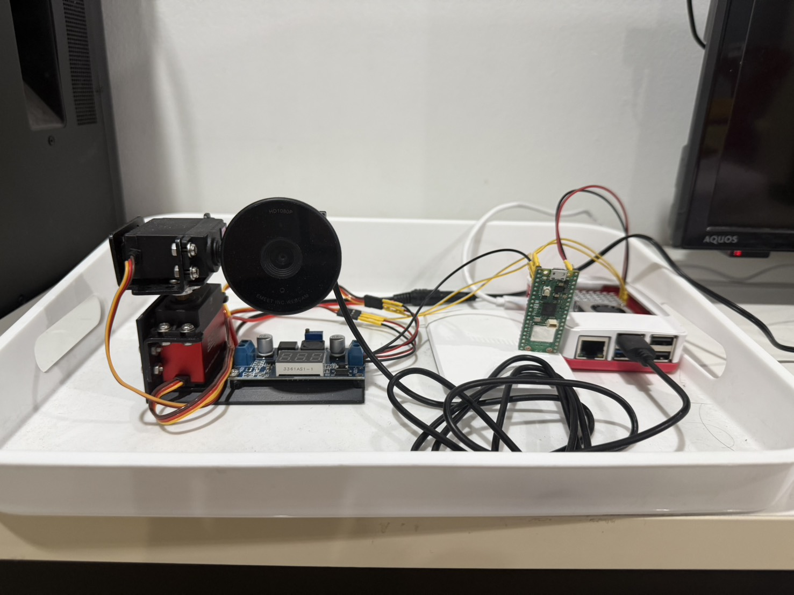
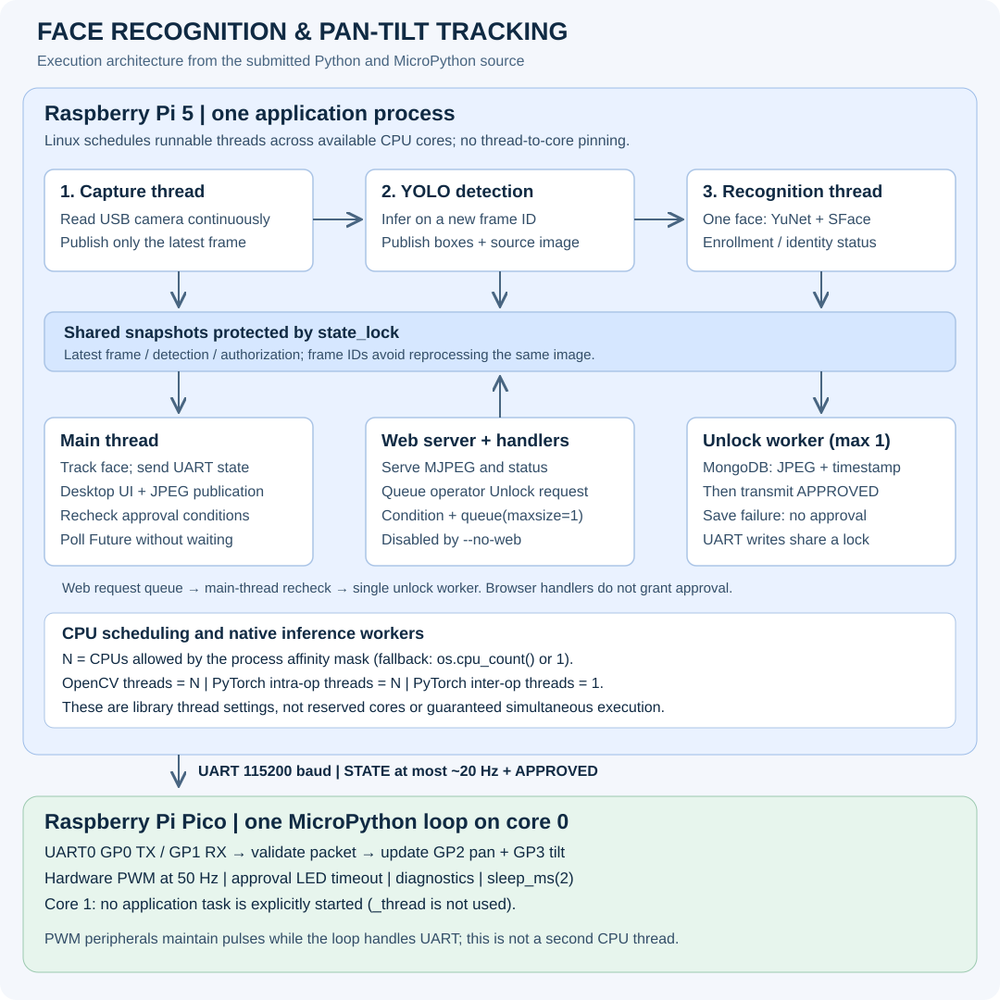

# Face Recognition & Pan–Tilt Tracking
### Raspberry Pi 5 · Raspberry Pi Pico · YOLO · YuNet · SFace

Real-time face tracking, identity verification, and operator-approved access logging.

[Overview](#overview) · [System & threads](#system-design) · [Hardware](#hardware) · [Setup](#installation) · [References](#references)

---

<em>Assembled prototype: pan-and-tilt webcam and servo assembly (left), LM2596 step-down module (front), and Raspberry Pi with the Pico controller (right).</em>

| Project | Details |
| :--- | :--- |
| Repository | YOLO_face_detect-reconize |
| Main processor | Raspberry Pi 5 |
| Servo controller | Raspberry Pi Pico via UART, 115200 baud |
| Vision pipeline | YOLO face detection → YuNet landmarks → SFace recognition |
| Execution | Capture, detection, recognition, HTTP and database worker threads |
| CPU use | Linux chooses a CPU core for each thread; jobs are not tied to fixed cores |
| Interface | Live web dashboard with operator approval |
| Records | Approved capture image and timestamp in MongoDB |

## Contents

1. [Project overview](#overview)
2. [Theory and related work](#theory)
3. [System design, multithreading and CPU cores](#system-design)
4. [Hardware](#hardware)
5. [Repository guide](#repository-guide)
6. [Installation and operation](#installation) — [face enrollment](#face-enrollment)
7. [Verification and current scope](#verification)
8. [References](#references)

## 1. Project overview

### Rationale

Security systems benefit from identifying authorized users and maintaining a record of access approvals. A fixed camera may lose a useful view when a person moves. This project combines facial recognition with a two-axis pan-and-tilt mechanism to keep a detected face near the center of the camera frame.

The Raspberry Pi 5 processes camera images and provides a live web dashboard. Once an enrolled user is recognized, an operator can press **Unlock** to approve access. The application saves a capture image and timestamp in MongoDB before sending the approval command to the Pico.

### Objectives

- Detect faces and follow a selected target using pan and tilt servos.
- Verify the enrolled user's identity using aligned face features.
- Display the live camera feed and recognition status on a web dashboard.
- Record operator-approved events before transmitting approval over UART.
- Separate image processing on the Pi 5 from servo PWM generation on the Pico.
- Keep camera capture, recognition and database I/O in separate execution paths so slow operations do not directly serialize the entire pipeline.

## 2. Theory and related work

### Face detection and recognition

**YOLO** provides the face locations used by the tracking controller. Redmon et al. introduced the unified detection approach that underpins the YOLO family [1]. **YuNet** supplies facial landmarks for alignment within the detected face region [3]. **SFace** extracts feature vectors from aligned faces, which are compared with enrolled features using cosine similarity [2].

### Pan-and-tilt tracking

The controller calculates the displacement between the face center and image center. It applies a dead zone, bounded angular corrections, and limits from 0° to 180°. This implementation uses image-error feedback rather than a complete PID controller.

### Related studies

| Study | Contribution | Connection to this project |
| :--- | :--- | :--- |
| Redmon et al. (2016) [1] | Unified real-time object detection | Basis of YOLO-based face localization |
| Zhong et al. (2021) [2] | SFace recognition features | Identity verification with cosine similarity |
| Wu, Peng & Yu (2023) [3] | Lightweight YuNet face detection | Facial landmarks and alignment |
| Elnozahy et al. (2025) [4] | Raspberry Pi facial-recognition door lock | Related access-control integration |
| Doloiu et al. (2025) [5] | YOLO and PID pan-and-tilt tracking | Related tracking architecture; this project uses simpler feedback |

The project integrates established techniques into a working prototype; it does not introduce a new recognition algorithm.

## 3. System design, multithreading and CPU cores

### 3.1 Execution diagram

[Open the full-size execution diagram](docs/system-threads.svg) · [Wiring and mechanical diagram (PDF)](Wiring%20and%20Mechanical%20Diagram.pdf)

**Top: what each thread does and where its results go. Bottom: Linux shares the four Pi 5 cores among these threads.** No thread is tied to a fixed core. Pico is a separate board that receives the commands and controls the servos.

### 3.2 Why use multiple threads?

Camera reads, neural-network inference, browser connections and MongoDB writes have different timing requirements. Running them sequentially in one loop would make the next camera read and tracking update wait for recognition or network I/O. The implementation separates these jobs and shares the newest available results rather than accumulating a queue of old camera frames.

The application creates **three persistent vision threads**, a **main coordination thread**, an optional **web-server thread with HTTP handler threads**, and a **single-worker executor for approved captures**. Native OpenCV and PyTorch operations may also use their own internal workers. The number of Python threads is therefore not a count of CPU cores.

### 3.3 What each thread does

A thread is a separate flow of work inside the program.

| Thread | Main job | Key condition |
| :--- | :--- | :--- |
| Capture | Read the camera and keep the newest image | Runs continuously |
| Detection | Find faces with YOLO | Process each new image once |
| Recognition | Register the owner or check their face | Requires one face; accept a match twice in a row |
| Main | Track the face, send servo angles and update the display | Send angles at most about 20 times/s; web images at most about 10 times/s |
| Web | Show live images and receive Unlock requests | Runs unless --no-web is used |
| Unlock worker | Save the image to MongoDB, then send APPROVED | One save task at a time; no approval if saving fails |

The program checks the save result later, so the main loop does not wait for an unfinished database task. During registration, it collects 60 face images and disables Unlock. The rates above are code limits, not measured performance.

### 3.4 CPU and thread settings

**The program uses multiple threads. Linux decides which CPU core runs each thread.** The code does not give each job its own fixed core.

**N means the number of CPU cores the program is allowed to use.** If all four Pi 5 cores are available, N = 4. The settings below control extra threads inside OpenCV and PyTorch:

| Setting in the code | Value when N = 4 | Simple meaning |
| :--- | :--- | :--- |
| cv2.setNumThreads(N) | 4 threads | Let OpenCV use 4 threads for image operations that support it |
| torch.set_num_threads(N) | 4 threads | Let PyTorch use 4 threads to help calculate one operation |
| torch.set_num_interop_threads(1) | 1 thread | Use 1 thread for work between PyTorch operations |

**The numbers 4 and 1 are thread counts, not core numbers.** The last setting does not make the whole program single-threaded. Camera, detection, recognition, web and save threads still exist separately.

Multiple threads let different jobs make progress without waiting for the whole pipeline. They do not guarantee that every job runs at the same instant or on a different core. Actual speed must be measured on the Pi.

### 3.5 Shared state and approval conditions

- **state_lock:** protects snapshots and updates of frames, boxes, detection IDs and authorization state. Inference is performed outside the lock after copying its input.
- **recognition_commands queue:** transfers registration/cancel commands to the recognition thread.
- **Monitor Condition:** protects web status and the newest JPEG, and wakes waiting streams when a frame arrives or the monitor closes.
- **Unlock request queue:** holds at most one pending browser request. Requests older than 1 second are rejected, and the main loop checks authorization again.
- **UART lock:** serializes STATE and APPROVED writes from the main loop and unlock worker so command bytes are not interleaved.
- **stop_event:** requests worker shutdown. Cleanup closes the web server and executor and joins the vision workers.

An Unlock request is submitted only when the status is AUTHORIZED, enrollment is inactive, exactly one face is present, the authorized image and detection are each less than 1 second old, no unlock Future is pending, and at least 3 seconds have elapsed since the previous accepted request.

**Approval sequence:** operator request → main-thread freshness/identity/cooldown checks → JPEG encoding → one unlock worker → MongoDB insert → APPROVED over UART. A failed initial database save prevents approval transmission.

### 3.6 Pico execution and hardware PWM

The Pico firmware is included as [main.py](main.py). It runs one MicroPython application loop on the main core. It does not import _thread or start an application task on core 1.

| Pico execution / peripheral | Responsibility |
| :--- | :--- |
| Main loop (core 0) | Read UART0, assemble newline-terminated packets, validate commands and update servo pulse settings |
| Core 1 | No application task is explicitly started in the inspected firmware |
| Hardware PWM | Maintain 50 Hz pulses on GP2 (pan) and GP3 (tilt), independently of repeated Python pulse generation |

The Pico accepts STATE,pan,tilt,0/1 and the legacy APPROVED command. Angles must be within 0°–180°; the configured pulse mapping is 500–2500 microseconds. STATE refreshes a 1-second LED deadline, while APPROVED alone uses 3 seconds. A silent link holds the last servo angles; the LED turns off when its deadline expires. Hardware PWM operation does not mean that a second CPU core is running the servo code.

The repository includes both the Pi 5 application, [yolo_face.py](yolo_face.py), and the Pico receiver, [main.py](main.py).

## 4. Hardware

| Component | Role |
| :--- | :--- |
| Raspberry Pi 5 | Vision processing, dashboard, database communication |
| Raspberry Pi Pico | UART receiver and servo PWM generation |
| EMEET C950 1080P camera | Camera input |
| MG996R servos | Pan-and-tilt movement |
| LM2596 step-down module | Voltage regulation for the hardware supply |

### Bill of materials

### LM2596 specification

### MG996R specification

### EMEET C950 1080P

## 5. Repository guide

| File | Purpose |
| :--- | :--- |
| [yolo_face.py](yolo_face.py) | Pi 5 application: threaded camera pipeline, enrollment and recognition |
| [main.py](main.py) | Pico MicroPython firmware: UART receiver, pan/tilt PWM and approval LED |
| [servo_tracking.py](servo_tracking.py) | Face-center tracking and bounded pan/tilt commands |
| [uart_commands.py](uart_commands.py) | Serial communication, angle state and APPROVED messages |
| [unlock_action.py](unlock_action.py) | Save the approved image before sending approval |
| [mongodb_config.py](mongodb_config.py) | Load the MongoDB URI from the local environment |
| [web_server.py](web_server.py) | Authenticated dashboard server and threaded HTTP handlers |
| [web_state.py](web_state.py) | Thread-safe monitoring state and bounded request queue |
| [monitor.html](monitor.html) | Dashboard HTML, CSS and JavaScript |
| [yolo-face.service](yolo-face.service) | Example systemd service for startup on boot |
| [docs/system-threads.svg](docs/system-threads.svg) | Static execution diagram showing threads, scheduling and Pico control |
| [model.pt](model.pt) | YOLO face-detector weights |
| [face_detection_yunet_2023mar.onnx](face_detection_yunet_2023mar.onnx) | YuNet model |
| [Wiring and Mechanical Diagram.pdf](Wiring%20and%20Mechanical%20Diagram.pdf) | Wiring and mechanical documentation |

**Additional files required:** the SFace model, local configuration and owner enrollment data are not included in the repository.

## 6. Installation and operation

### 6.1 Prepare the Raspberry Pi 5

Create a project virtual environment and install the Python dependencies:

~~~bash
python3 -m venv .venv
source .venv/bin/activate
python -m pip install ultralytics opencv-python numpy pyserial flask pymongo
~~~

The application also imports PyTorch, which is a dependency of Ultralytics. Use package builds compatible with the Pi's operating system and Python version.

### 6.2 Prepare the models

Keep model.pt beside yolo_face.py. Create a models directory beside the script and place both ONNX models inside it:

- model.pt — included YOLO face-detector weights.
- models/face_detection_yunet_2023mar.onnx — move the included YuNet model from the repository root into models/.
- models/face_recognition_sface_2021dec.onnx — download separately from [OpenCV Zoo](https://github.com/opencv/opencv_zoo/tree/main/models/face_recognition_sface).

### 6.3 Configure UART

If header UART0 is not enabled, edit /boot/firmware/config.txt and add the following under [all], then reboot:

~~~ini
dtoverlay=uart0-pi5
~~~

| Raspberry Pi 5 | Raspberry Pi Pico |
| :--- | :--- |
| GPIO14 TX — physical pin 8 | GP1 RX — physical pin 2 |
| GPIO15 RX — physical pin 10 | GP0 TX — physical pin 1 |
| GND | GND |

Set both devices to **115200 baud**. The inspected Pico firmware uses GP2 for pan and GP3 for tilt. Follow the wiring PDF for power and servo connections.

### 6.4 Configure the database and dashboard

The application reads MONGODB_URI from the environment or a neighboring .env file. Its default database and collection are face_access and unlock_events.

~~~dotenv
MONGODB_URI=mongodb://localhost:27017
~~~

To choose a persistent dashboard password for an interactive run, export FACE_WEB_PASSWORD in the shell before launching. If it is not provided, the application generates a password at startup. Keep private settings in local configuration.

### 6.5 Run the application

~~~bash
source .venv/bin/activate
python yolo_face.py --uart-port /dev/ttyAMA0 --uart-baud 115200
~~~

| Option | Purpose |
| :--- | :--- |
| --no-uart | Run recognition without serial commands |
| --headless | Run without the desktop camera window |
| --no-web | Disable the dashboard |
| --web-port 5000 | Set the dashboard port; default is 5000 |
| --pan-direction -1 | Set horizontal tracking direction to -1 or 1 |
| --tilt-direction 1 | Set vertical tracking direction to -1 or 1 |

Open the Pi's IP address on port 5000 in a browser. The dashboard username is admin; use the configured or generated password reported by the application. Complete owner enrollment before using approval.

### 6.6 Enroll and save the owner's face

The program stores **one owner's reference image set**. Enrollment creates SFace features for matching; it does not retrain YOLO, YuNet or SFace, and it does not create separate named accounts for multiple people.

#### Start enrollment from the Pi desktop

1. Run the application in a graphical desktop session **without --headless**, using the command in section 6.5. Keep the required models and configured MongoDB connection available. If the startup service already owns the camera, stop that instance before starting the interactive application.
2. Click the **YOLO Face Recognition** camera window so it receives keyboard input. Use the English keyboard layout.
3. Keep exactly one face in view, then press lowercase **r** once. The display changes to REGISTERING 0/60. No Register button or enrollment API is implemented in the current web dashboard.
4. Let the system collect valid face images automatically. Follow the on-screen guidance below; there is no shutter key for each image.
5. Wait for the terminal message **Registration complete: 60 face samples saved in .../owner_faces**. The status initially returns to UNKNOWN, then can become AUTHORIZED after two consecutive accepted matches.

| Current sample count | On-screen guidance | What to do |
| :--- | :--- | :--- |
| 0–19 | FACE FORWARD | Face the camera clearly |
| 20–39 | TURN LEFT/RIGHT | Slowly vary the face angle while remaining detectable |
| 40–59 | VARY LIGHTING | Vary the lighting while keeping the face visible |
| 60 saved samples | Registration complete (terminal) | Enrollment finishes and normal recognition resumes |

Collection continues automatically at counts 20 and 40. The terminal prompts at these points do not pause capture or wait for a confirmation key. Completion time depends on the number of usable detections, not a fixed countdown.

#### Which images are accepted?

The recognition thread processes a new detection ID and requires exactly one YOLO face box. It crops that face, asks YuNet for landmarks, aligns it for SFace, and normalizes the extracted feature vector. A crop smaller than 20 pixels in either dimension, missing landmarks, or an invalid embedding is rejected. The sample counter increases only when cv2.imwrite successfully saves the cropped JPEG.

While collecting, multiple/no faces produce the ONE FACE ONLY guidance. An embedding failure can show UNKNOWN - FACE ALIGNMENT FAILED. Adjust the face position and continue; a rejected frame does not count toward the 60 samples. Unlock is disabled during enrollment.

#### Where the reference data is saved

Paths are relative to the folder containing yolo_face.py, not the terminal's current directory:

~~~text
project/
├── yolo_face.py
├── .owner_faces_pending/      temporary set while collecting
│   ├── owner_000.jpg
│   └── ...
└── owner_faces/               completed owner reference set
    ├── owner_000.jpg
    ├── owner_001.jpg
    ├── ...
    └── owner_059.jpg
~~~

During collection, the cropped source face images are written into .owner_faces_pending. Once 60 images have been saved, the code removes any existing owner_faces directory and moves the pending directory into its place. **Completing enrollment again replaces the previous owner image set.** This is one owner's replacement set, not an additional user profile.

The SFace embeddings are held in memory. On the next launch, load_owner_embeddings reads the JPEGs in owner_faces and recomputes their features; there is no separately saved embedding file in this implementation. At least one valid loaded embedding is needed for the program to treat the owner as registered, although normal enrollment collects 60 images.

#### Cancel, enroll again and run headless

| Key / operation | Actual behavior |
| :--- | :--- |
| lowercase r | Start a new enrollment when enrollment is inactive |
| lowercase q during enrollment | Cancel collection, remove the temporary pending folder and keep the previous completed registration |
| lowercase q outside enrollment | Exit the interactive application |
| k or K | Request Unlock; does not add enrollment samples |
| Web Unlock button | Request an approval capture; does not register a face |
| --headless | Reuse saved owner_faces; no desktop key input is available for starting enrollment |

The overlay labels use uppercase letters, but the code checks lowercase r and q. Enroll interactively first, then exit and restart with --headless or the configured startup service. To replace the registered owner, repeat enrollment and complete a new set of 60 samples. The previous set remains in use if the new collection is cancelled before completion.

#### Enrollment images versus approval captures

| Data | Trigger | Storage | Purpose |
| :--- | :--- | :--- | :--- |
| Owner reference crops | Press r, then automatic collection | Local owner_faces/owner_000.jpg through owner_059.jpg | Rebuild SFace reference features for identity matching |
| Approved capture | Fresh authorized match plus operator Unlock or k/K | MongoDB face_access.unlock_events | Store the authorized source-frame JPEG, UTC timestamp and UART submission status |

Approval captures are not added to owner_faces and do not automatically update the registered identity. The dashboard's Recent captures section displays the latest 20 approval events; an empty history does not mean that enrollment images are missing.

### 6.7 Pico and startup service

Copy the included [main.py](main.py) to the Pico as main.py using Thonny and compatible MicroPython firmware. This file runs on the Pico; run yolo_face.py on the Pi 5. The receiver validates UART commands, updates hardware PWM and shows approval status; it does not start a second-core application thread.

For automatic startup, adapt User, WorkingDirectory, EnvironmentFile and ExecStart in [yolo-face.service](yolo-face.service) to the actual Pi account and project directory before installing the unit. Configure UART, MongoDB and enrollment first. The provided unit does not set CPUAffinity.

## 7. Verification and current scope

The following checklist describes checks to perform on the assembled hardware; it is not a report of measured test results.

- Confirm the live camera feed and face-detection overlay appear.
- Move the target left/right and up/down; verify the servos follow in the correct direction.
- Check enrolled-user recognition and rejection of a different person.
- Confirm approval requires a fresh owner match and operator action.
- Confirm the approved image and timestamp are saved before APPROVED is transmitted.
- Disconnect the database and verify a failed save does not grant approval.
- Verify tracking and preview updates continue while a database task is pending.
- Measure per-thread/per-core CPU use and achieved frame rates on the Pi; do not infer them from thread counts.
- Disconnect UART and check that the Pico holds its angles and the approval LED times out.
- Restart the Pi and verify the service after its local paths have been configured.

**Current scope:** this repository provides the Pi 5 application, Pico firmware and execution diagram. Approval signaling and the Pico LED indication do not by themselves demonstrate a physical door-lock actuator. Hardware performance measurements and a completed test-results table can be added for a fuller submission.

## 8. References

1. Redmon, J., Divvala, S., Girshick, R., & Farhadi, A. (2016). *You Only Look Once: Unified, Real-Time Object Detection.* CVPR. [Paper](https://arxiv.org/abs/1506.02640)
2. Zhong, Y., Deng, W., Hu, J., Zhao, D., Li, X., & Wen, D. (2021). *SFace: Sigmoid-Constrained Hypersphere Loss for Robust Face Recognition.* IEEE Transactions on Image Processing, 30, 2587–2598. [DOI](https://doi.org/10.1109/TIP.2020.3048632)
3. Wu, W., Peng, H., & Yu, S. (2023). *YuNet: A Tiny Millisecond-level Face Detector.* Machine Intelligence Research, 20, 656–665. [DOI](https://doi.org/10.1007/s11633-023-1423-y)
4. Elnozahy, S. S. F. A., Pari, S. C., & Liang, L. C. (2025). *Raspberry Pi-Based Face Recognition Door Lock System.* IoT, 6(2), 31. [DOI](https://doi.org/10.3390/iot6020031)
5. Doloiu, M. D., et al. (2025). *Modeling and Control of a Pan–Tilt Servo System for Face Tracking Using Deep Learning and PID.* Engineering Proceedings, 113(1), 75. [DOI](https://doi.org/10.3390/engproc2025113075)

Implementation background: [Python threading and the GIL](https://docs.python.org/3/library/threading.html#gil-and-performance-considerations) · [MicroPython RP2 peripherals](https://docs.micropython.org/en/latest/rp2/quickref.html)
