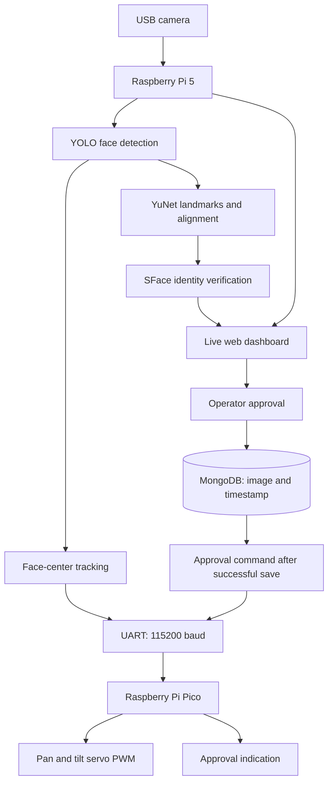

<div align="center">

# Face Recognition & Pan–Tilt Tracking
### Raspberry Pi 5 · Raspberry Pi Pico · YOLO · YuNet · SFace

Real-time face tracking, identity verification, and operator-approved access logging.

[Overview](#1-project-overview) · [System design](#3-system-design) · [Hardware](#4-hardware) · [Setup](#6-installation-and-operation) · [References](#8-references)

</div>

---

| Project | Details |
| :--- | :--- |
| Repository | YOLO_face_detect-reconize |
| Main processor | Raspberry Pi 5 |
| Servo controller | Raspberry Pi Pico via UART, 115200 baud |
| Vision pipeline | YOLO face detection → YuNet landmarks → SFace recognition |
| Interface | Live web dashboard with operator approval |
| Records | Approved capture image and timestamp in MongoDB |

## Contents

1. [Project overview](#1-project-overview)
2. [Theory and related work](#2-theory-and-related-work)
3. [System design](#3-system-design)
4. [Hardware](#4-hardware)
5. [Repository guide](#5-repository-guide)
6. [Installation and operation](#6-installation-and-operation)
7. [Verification and current scope](#7-verification-and-current-scope)
8. [References](#8-references)

## 1. Project overview

### Rationale

Security systems benefit from identifying authorized users and maintaining a record of access approvals. A fixed camera may lose a useful view when a person moves. This project combines facial recognition with a two-axis pan-and-tilt mechanism to keep a detected face near the center of the camera frame.

The Raspberry Pi 5 processes camera images and provides a live web dashboard. Once an enrolled user is recognized, an operator can press **Unlock** to approve access. The application saves a capture image and timestamp in MongoDB before sending the approval command to the Pico.

### Objectives

- Detect faces and follow a selected target using pan and tilt servos.
- Verify the enrolled user's identity using aligned face features.
- Display the live camera feed and recognition status on a web dashboard.
- Record operator-approved events before transmitting approval over UART.
- Separate image processing on the Pi 5 from servo PWM generation on the Pico.

## 2. Theory and related work

### Face detection and recognition

**YOLO** provides the face locations used by the tracking controller. Redmon et al. introduced the unified detection approach that underpins the YOLO family [1]. **YuNet** supplies facial landmarks for alignment within the detected face region [3]. **SFace** extracts feature vectors from aligned faces, which are compared with enrolled features using cosine similarity [2].

### Pan-and-tilt tracking

The controller calculates the displacement between the face center and image center. It applies a dead zone, bounded angular corrections, and limits from 0° to 180°. This implementation uses image-error feedback rather than a complete PID controller.

### Related studies

| Study | Contribution | Connection to this project |
| :--- | :--- | :--- |
| Redmon et al. (2016) [1] | Unified real-time object detection | Basis of YOLO-based face localization |
| Zhong et al. (2021) [2] | SFace recognition features | Identity verification with cosine similarity |
| Wu, Peng & Yu (2023) [3] | Lightweight YuNet face detection | Facial landmarks and alignment |
| Elnozahy et al. (2025) [4] | Raspberry Pi facial-recognition door lock | Related access-control integration |
| Doloiu et al. (2025) [5] | YOLO and PID pan-and-tilt tracking | Related tracking architecture; this project uses simpler feedback |

The project integrates established techniques into a working prototype; it does not introduce a new recognition algorithm.

## 3. System design



**Approval sequence:** fresh owner match → operator presses Unlock → image is saved → approval command is transmitted.

[View wiring and mechanical diagram (PDF)](Wiring%20and%20Mechanical%20Diagram.pdf)

## 4. Hardware

| Component | Role |
| :--- | :--- |
| Raspberry Pi 5 | Vision processing, dashboard, database communication |
| Raspberry Pi Pico | UART receiver and servo PWM generation |
| EMEET C950 1080P camera | Camera input |
| MG996R servos | Pan-and-tilt movement |
| LM2596 step-down module | Voltage regulation for the hardware supply |
| Pan-and-tilt assembly and wiring | Camera mounting and electrical connections |

### Hardware overview

<p align="center">

</p>

### LM2596 specification

<p align="center">

</p>

### MG996R specification

<p align="center">


</p>

### EMEET C950 1080P

<p align="center">


</p>

## 5. Repository guide

| File | Purpose |
| :--- | :--- |
| [yolo_face.py](yolo_face.py) | Main application, camera processing, enrollment and recognition |
| [servo_tracking.py](servo_tracking.py) | Face-center tracking and bounded pan/tilt commands |
| [uart_commands.py](uart_commands.py) | Serial communication, angle state and APPROVED messages |
| [unlock_action.py](unlock_action.py) | Save the approved image before sending approval |
| [mongodb_config.py](mongodb_config.py) | Load the MongoDB URI from the local environment |
| [web_server.py](web_server.py) | Authenticated dashboard server |
| [web_state.py](web_state.py) | Thread-safe monitoring state |
| [monitor.html](monitor.html) | Dashboard HTML, CSS and JavaScript |
| [yolo-face.service](yolo-face.service) | Example systemd service for startup on boot |
| [model.pt](model.pt) | YOLO face-detector weights |
| [face_detection_yunet_2023mar.onnx](face_detection_yunet_2023mar.onnx) | YuNet model |
| [Wiring and Mechanical Diagram.pdf](Wiring%20and%20Mechanical%20Diagram.pdf) | Wiring and mechanical documentation |

**Additional files required:** the SFace model, local configuration and owner enrollment data are not included in the repository. The Pico receiver firmware described as main.py must also be supplied separately.

## 6. Installation and operation

### 6.1 Prepare the Raspberry Pi 5

Create a project virtual environment and install the Python dependencies:

```bash
python3 -m venv .venv
source .venv/bin/activate
python -m pip install ultralytics opencv-python numpy pyserial flask pymongo
```

The application also imports PyTorch, which is a dependency of Ultralytics. Use package builds compatible with the Pi's operating system and Python version.

### 6.2 Prepare the models

Keep the following model files beside yolo_face.py:

- model.pt — included YOLO face-detector weights.
- face_detection_yunet_2023mar.onnx — included YuNet model.
- face_recognition_sface_2021dec.onnx — download separately from [OpenCV Zoo](https://github.com/opencv/opencv_zoo/tree/main/models/face_recognition_sface).

### 6.3 Configure UART

If header UART0 is not enabled, edit /boot/firmware/config.txt and add the following under [all], then reboot:

```ini
dtoverlay=uart0-pi5
```

| Raspberry Pi 5 | Raspberry Pi Pico |
| :--- | :--- |
| GPIO14 TX — physical pin 8 | GP1 RX — physical pin 2 |
| GPIO15 RX — physical pin 10 | GP0 TX — physical pin 1 |
| GND | GND |

Set both devices to **115200 baud**. Follow the wiring PDF for power and servo connections.

### 6.4 Configure the database and dashboard

The application reads MONGODB_URI from the environment or a neighboring .env file. Its default database and collection are face_access and unlock_events.

```dotenv
MONGODB_URI=mongodb://localhost:27017
```

To choose a persistent dashboard password for an interactive run, export FACE_WEB_PASSWORD in the shell before launching. If it is not provided, the application generates a password at startup. Keep private settings in local configuration.

### 6.5 Run the application

```bash
source .venv/bin/activate
python yolo_face.py --uart-port /dev/ttyAMA0 --uart-baud 115200
```

| Option | Purpose |
| :--- | :--- |
| --no-uart | Run recognition without serial commands |
| --headless | Run without the desktop camera window |
| --no-web | Disable the dashboard |
| --web-port 5000 | Set the dashboard port; default is 5000 |
| --pan-direction -1 | Set horizontal tracking direction to -1 or 1 |
| --tilt-direction 1 | Set vertical tracking direction to -1 or 1 |

Open the Pi's IP address on port 5000 in a browser and authenticate with the dashboard credentials reported by the application. Complete owner enrollment before using approval.

### 6.6 Pico and startup service

The Pico receiver must interpret the UART commands, generate servo PWM and show approval status. Its firmware is not currently included in this repository.

For automatic startup, adapt User, WorkingDirectory, EnvironmentFile and ExecStart in [yolo-face.service](yolo-face.service) to the actual Pi account and project directory before installing the unit. Configure UART, MongoDB and enrollment first.

## 7. Verification and current scope

The following checklist describes checks to perform on the assembled hardware; it is not a report of measured test results.

- Confirm the live camera feed and face-detection overlay appear.
- Move the target left/right and up/down; verify the servos follow in the correct direction.
- Check enrolled-user recognition and rejection of a different person.
- Confirm approval requires a fresh owner match and operator action.
- Confirm the approved image and timestamp are saved before APPROVED is transmitted.
- Disconnect the database and verify a failed save does not grant approval.
- Restart the Pi and verify the service after its local paths have been configured.

**Current scope:** this repository provides the Pi-side application. Approval signaling and the Pico LED indication do not by themselves demonstrate a physical door-lock actuator. Hardware performance measurements, a completed test-results table and the Pico firmware can be added for a fuller submission.

## 8. References

1. Redmon, J., Divvala, S., Girshick, R., & Farhadi, A. (2016). *You Only Look Once: Unified, Real-Time Object Detection.* CVPR. [Paper](https://arxiv.org/abs/1506.02640)
2. Zhong, Y., Deng, W., Hu, J., Zhao, D., Li, X., & Wen, D. (2021). *SFace: Sigmoid-Constrained Hypersphere Loss for Robust Face Recognition.* IEEE Transactions on Image Processing, 30, 2587–2598. [DOI](https://doi.org/10.1109/TIP.2020.3048632)
3. Wu, W., Peng, H., & Yu, S. (2023). *YuNet: A Tiny Millisecond-level Face Detector.* Machine Intelligence Research, 20, 656–665. [DOI](https://doi.org/10.1007/s11633-023-1423-y)
4. Elnozahy, S. S. F. A., Pari, S. C., & Liang, L. C. (2025). *Raspberry Pi-Based Face Recognition Door Lock System.* IoT, 6(2), 31. [DOI](https://doi.org/10.3390/iot6020031)
5. Doloiu, M. D., et al. (2025). *Modeling and Control of a Pan–Tilt Servo System for Face Tracking Using Deep Learning and PID.* Engineering Proceedings, 113(1), 75. [DOI](https://doi.org/10.3390/engproc2025113075)
